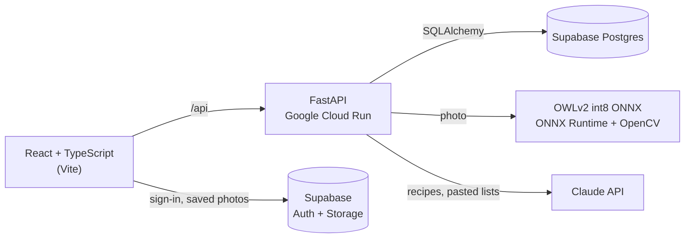
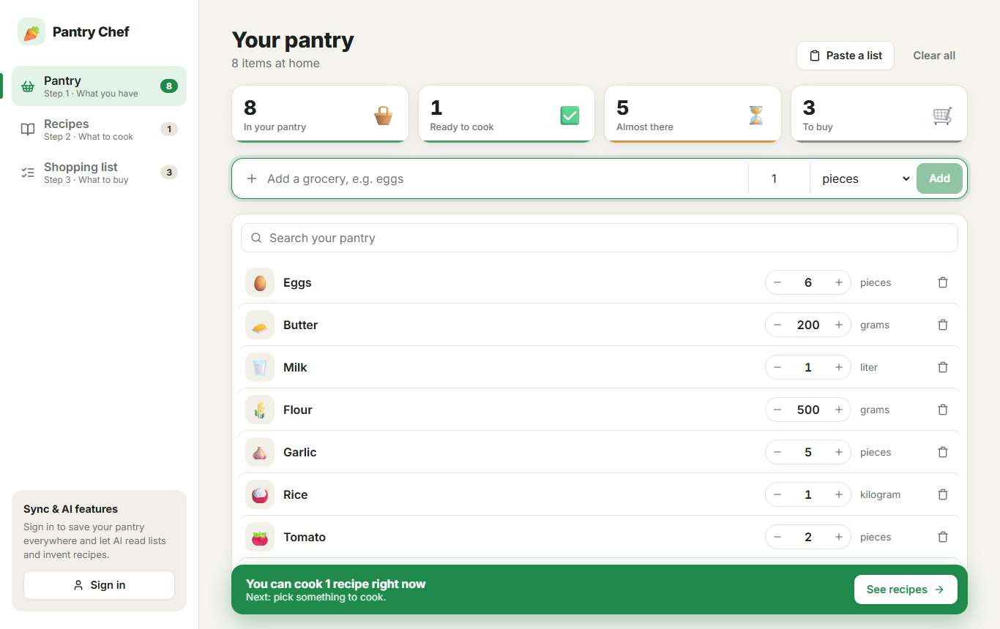
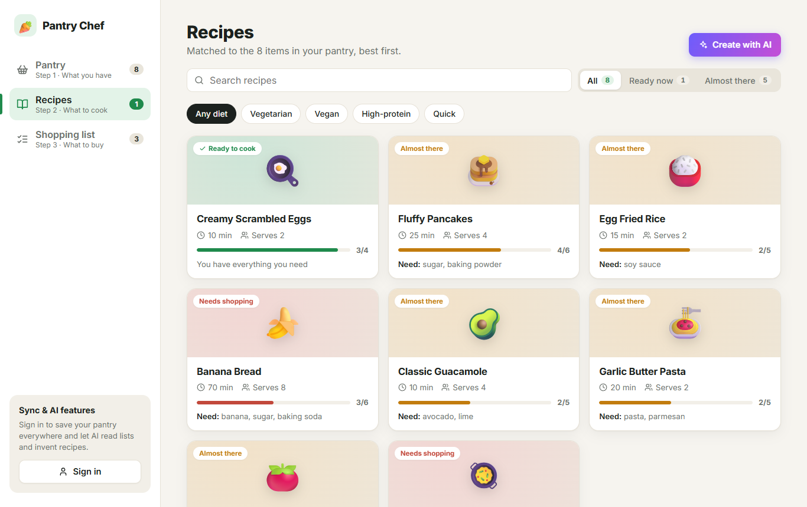
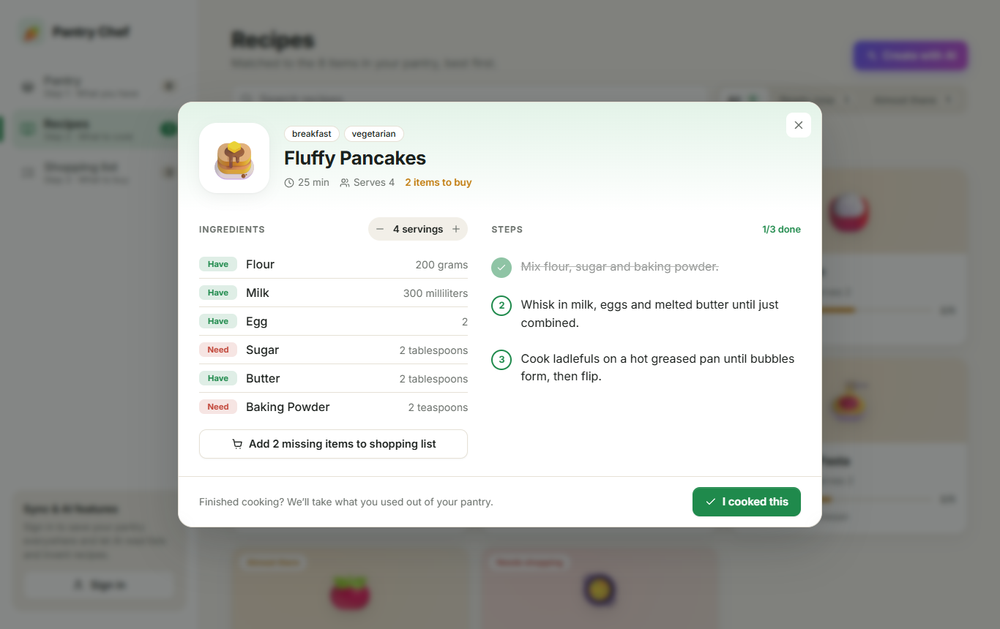
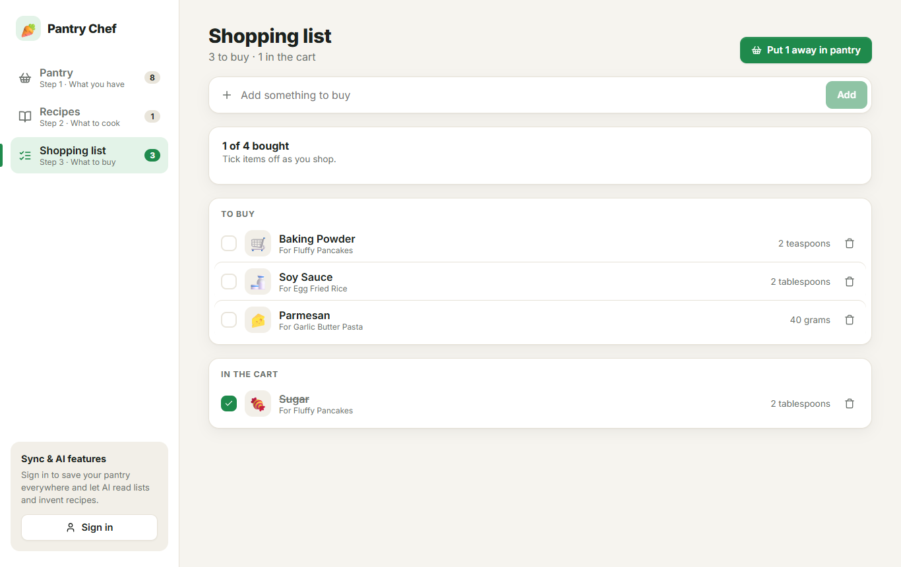
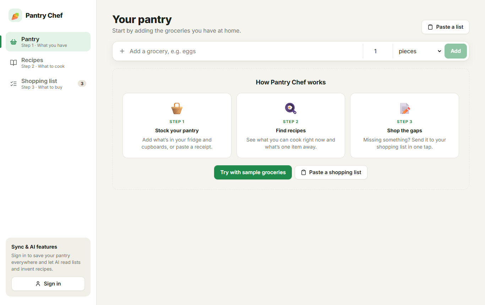
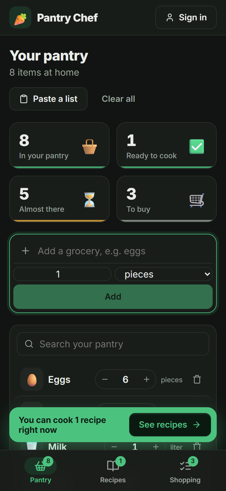
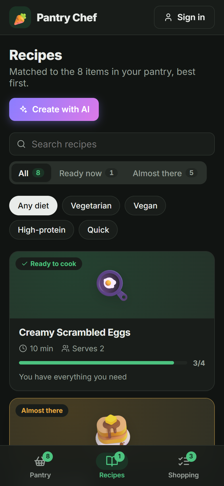
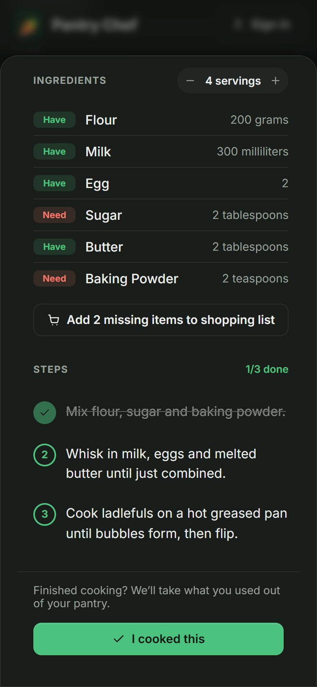

# 🥕 Pantry Chef

Pantry Chef suggests recipes based on the groceries you have. Enter what's in your kitchen and how much of it, and it ranks recipes by how much of each one you can already cover. It shows which ingredients you have, which are running low and which you need to buy.

> 🚧 **This is an ongoing project under active development.** The API is deployed on Google Cloud Run. The web app runs locally for now and reads recipes and matches from that API. Expect breaking changes; see [docs/ROADMAP.md](docs/ROADMAP.md) for where things are headed.

## Highlights

- **Full-stack app:**
  - The frontend is React 19 and TypeScript.
  - The API is FastAPI with SQLAlchemy, on Supabase Postgres with row level security.
  - Sign-in uses Supabase Auth, and the API checks every login token itself (ES256 signatures, verified against Supabase's published keys).
- **Computer vision instead of a paid LLM:**
  - Grocery photos are counted by [OWLv2](https://huggingface.co/google/owlv2-base-patch16-ensemble), an open-vocabulary detector from the Hugging Face Hub.
  - It runs as an int8 ONNX model on the CPU with ONNX Runtime, with OpenCV and NumPy preparing the image. That means no per-photo API cost and no PyTorch.
- **Model chosen by measurement:**
  - Six open-vocabulary detectors were benchmarked on a labeled 11-photo test set. Each got the same food list and the same box clean-up.
  - OWLv2 passed 15 of 24 checks (63%), against 3–12 for the others, and added the fewest wrong items. [Results](#how-photo-detection-works)
- **The LLM only where it earns its cost:**
  - Claude generates recipes and turns pasted lists into items. It's called from the server only.
  - Its replies are checked against a Pydantic schema, and AI requests are rate-limited per user.
- **Deployed:**
  - The API runs as a Docker container on Google Cloud Run. It scales to zero when idle, and the model is built into the image, so a new instance never downloads it.
  - Secrets are kept in Secret Manager, and one script does the whole deploy. It's safe to re-run.
- **Tested:**
  - 139 pytest tests fake the database and the Claude API, so they run without secrets or network access.
  - GitHub Actions runs them, along with ruff, oxlint and a production build.

## Architecture



## Screenshots



| Recipes matched to your pantry | Recipe detail |
| --- | --- |
|  |  |
| **Shopping list** | **First run** |
|  |  |

<p align="center">
  
  
  
</p>

## Features

- **Three-step flow:** **Pantry → Recipes → Shopping list**, with a sidebar on desktop and a bottom tab bar on mobile. Each step shows a live count.

- **Grocery input with amounts and units:** pieces, grams, kilograms, milliliters, liters, teaspoons, tablespoons, cups. If you add the same item twice, the amounts are merged. Each item has −/+ steppers and a food emoji, and stat widgets summarize what you can cook.
- **Smart matching:**
  - Units are converted, so 1 kg of rice covers a recipe that needs 250 g.
  - Simple plurals match their singular ("tomatoes" matches "tomato").
  - Mass and volume are compared approximately (about 1 g per ml).
  - Optional ingredients count for less.
- **Ranked results** with a coverage meter, search, **Ready now** / **Almost there** tabs and dietary chips (vegetarian, vegan, …).
- **Recipe detail view:** each ingredient is labelled Have, Low or Need. A servings stepper scales quantities, and you can tick off steps as you cook. **Add missing items to shopping list** sends what you lack to your list. **I cooked this** takes the ingredients you used out of your pantry.
- **Shopping list:** to-buy and in-cart sections with a progress bar. **Put away in pantry** moves bought items back into your pantry. The list is stored in this browser.
- **Undo** for removing items, clearing the pantry and cooking, plus smooth view, card and list animations (turned off under reduced-motion settings).
- **Accounts and sync:** sign in with an email magic link (Supabase Auth) and your pantry is saved to the API. Signed out, it's stored in `localStorage`.
- **Smart features (signed-in users):**
  - **Scan groceries:** on a phone, the button offers to take a photo or pick one from your library. Photograph your fridge, a shelf or the shopping on your counter, and a local detector (no LLM, free to run) **counts the food it sees**: "6 eggs, 3 bananas, 2 milk". Every count is in pieces, and items the detector isn't sure about are marked **Not sure**. You review, edit or add items before saving; tapping a row highlights what was counted on the photo. Photos are shrunk in the browser first, so they upload quickly over mobile data. See [How photo detection works](#how-photo-detection-works).
  - **Saved photos:** each photo is kept in your account (a private Supabase Storage folder only you can read) and shown under **Your photos**, where you can read it again or delete it.
  - **Paste a list:** paste a typed grocery list and Claude turns it into items you review before adding.
  - **Cook something from my pantry:** Claude writes a recipe around what you have, with optional dietary, time and servings constraints. Generated recipes are clearly marked **AI-generated**.
- **Responsive and dark-mode aware.**

## Tech stack

| Layer    | Choice                                     |
| -------- | ------------------------------------------ |
| UI       | React 19 + TypeScript                      |
| Build    | Vite                                       |
| Lint     | oxlint (frontend), ruff (backend)          |
| API      | FastAPI + SQLAlchemy 2.0                   |
| Database | Supabase Postgres                          |
| Auth     | Supabase Auth (`supabase-js`), verified by the API |
| AI       | Claude API via the `anthropic` Python SDK (server-side only) |
| Vision   | [OWLv2](https://huggingface.co/google/owlv2-base-patch16-ensemble) from the Hugging Face Hub, run with ONNX Runtime; OpenCV + NumPy for image processing |
| CI       | GitHub Actions: lint + build, ruff + pytest |
| Hosting  | API: Docker container on Google Cloud Run, secrets in Secret Manager ([how](#deploy-the-api-to-google-cloud-run)) |

## Getting started

Requires **Node.js 20+**.

```bash
git clone https://github.com/Kev1nDang/pantry-chef.git
cd pantry-chef
npm install
npm run dev
```

Then open http://localhost:5173. Recipes come from the API, so start the backend too (below).

**Sign-in (optional):** copy [`.env.example`](.env.example) to `.env.local` and set `VITE_SUPABASE_URL` and `VITE_SUPABASE_ANON_KEY` (Supabase dashboard → Project Settings → API). In Supabase → Authentication → URL Configuration, add `http://localhost:5173` to the redirect URLs so magic links come back to the dev server. Without these variables the app runs signed out and the AI features are unavailable.

| Script            | What it does                         |
| ----------------- | ------------------------------------ |
| `npm run dev`     | Start the dev server with hot reload |
| `npm run build`   | Type-check and build to `dist/`      |
| `npm run preview` | Serve the production build locally   |
| `npm run lint`    | Lint with oxlint                     |

### Backend

Requires **Python 3.11+** and a [Supabase](https://supabase.com) project.

1. **Create the database schema.** Either run `npx supabase link --project-ref <ref>` and then `npx supabase db push --include-seed`, or paste each file in [`supabase/migrations/`](supabase/migrations) in order, followed by [`supabase/seed.sql`](supabase/seed.sql), into the Supabase SQL editor.
2. **Configure and run the API:**

   ```bash
   cd backend
   python -m venv .venv
   .venv/Scripts/activate        # macOS/Linux: source .venv/bin/activate
   pip install -r requirements-dev.txt
   cp .env.example .env          # fill in DATABASE_URL, SUPABASE_URL and ANTHROPIC_API_KEY
   fastapi dev app/main.py       # http://localhost:8000/docs
   ```

3. **Run checks:** `pytest`, `ruff check .` and `ruff format --check .`. Tests fake the database and the Claude API, so they need no secrets or network.

While both servers are running, the Vite dev server forwards `/api/*` to `localhost:8000`. If that port is taken (on Windows, Hyper-V/WSL can reserve it), run the API with `fastapi dev app/main.py --port 8001` and set `API_PROXY_TARGET=http://localhost:8001` in `.env.local`.

| Method | Path                | Auth | Purpose                           |
| ------ | ------------------- | ---- | --------------------------------- |
| GET    | `/api/health`       |      | API and database status           |
| GET    | `/api/recipes`      |      | List recipes (`?q=` searches titles, `?tag=vegan` filters, repeatable) |
| GET    | `/api/recipes/{id}` |      | Recipe detail                     |
| POST   | `/api/recipes/match` |     | Body `{pantry, tags?}` → ranked matches |
| POST   | `/api/recipes/generate` | ✓ AI | Body `{pantry?, dietary?, maxMinutes?, servings?}` → an AI-generated recipe, matched against the pantry |
| GET    | `/api/pantry`       | ✓    | The signed-in user's groceries    |
| PUT    | `/api/pantry`       | ✓    | Replace the user's grocery list   |
| POST   | `/api/pantry/parse` | ✓ AI | Body `{text}` → parsed items to review (nothing is saved) |
| POST   | `/api/pantry/detect` | ✓    | Multipart `file`: a photo → the foods counted by the local detector (amounts in `pcs`, each with a `confidence`), plus the boxes behind the counts. No LLM |

Saved photos don't go through the API: the web app uploads them straight to the private `pantry-photos` Storage bucket with the user's session, and row level security keeps each user to their own `<user id>/` folder ([migration](supabase/migrations/20261026000000_pantry_photos.sql)).

Authenticated routes expect a Supabase access token in the `Authorization: Bearer <jwt>` header. JSON uses camelCase, matching `src/types.ts`.

**AI routes** call Claude from the server only; the key never reaches the browser. They need a signed-in user, are limited to `AI_RATE_LIMIT_PER_MINUTE` requests per user (default 10, in memory per API process), and return `503` with a clear message when `ANTHROPIC_API_KEY` isn't set. The model defaults to `claude-sonnet-5-5` (`ANTHROPIC_MODEL`). Requests opt into Anthropic's server-side refusal fallback (`fallbacks: "default"`); set `ANTHROPIC_FALLBACKS=false` if you route through a gateway or cloud platform that doesn't support it.

## Project structure

```
backend/
├── app/
│   ├── main.py             # FastAPI app, CORS, routers
│   ├── config.py           # Settings from env / .env
│   ├── db.py               # SQLAlchemy engine + session dependency
│   ├── auth.py             # Supabase JWT verification (JWKS or legacy HS256)
│   ├── models.py           # ORM mappings
│   ├── schemas.py          # Pydantic models (mirror src/types.ts, camelCase on the wire)
│   ├── api/                # health, recipes (list/detail/match/generate), pantry (+ parse)
│   └── services/
│       ├── matching.py     # Recipe scoring/ranking
│       ├── units.py        # Unit conversion
│       ├── ai.py           # All Claude calls: pasted-list parsing, recipe generation
│       ├── documents.py    # Photo upload validation
│       ├── vision.py       # Local grocery detection: OWLv2 (ONNX) + OpenCV
│       └── ratelimit.py    # Per-user limit for AI routes
└── tests/                  # pytest; fakes for the DB session and Anthropic client
supabase/
├── migrations/             # SQL schema (source of truth), row level security, photo bucket
└── seed.sql                # Seed recipes
src/
├── App.tsx                 # App shell: navigation, recipe matching requests, dialogs, toasts
├── components/
│   ├── Sidebar.tsx         # Sidebar nav + account card; TabBar for mobile
│   ├── SignInDialog.tsx    # Magic-link sign-in
│   ├── PantryView.tsx      # Pantry page: stats, quick add, list, onboarding
│   ├── RecipesView.tsx     # Recipes page: search, tabs, diet chips, card grid
│   ├── ShoppingView.tsx    # Shopping list page
│   ├── StatTiles.tsx       # Count-up stat widgets
│   ├── GroceryForm.tsx     # Quick-add bar: name / amount / unit
│   ├── GroceryList.tsx     # Editable grocery list with steppers
│   ├── AddWithAIDialog.tsx # Photo (local detector) or pasted list (Claude) → review → add
│   ├── PhotoViewer.tsx     # A saved photo: read it again or delete it
│   ├── CookDialog.tsx      # AI: generate a recipe from the pantry
│   ├── RecipeCard.tsx      # Ranked result card with coverage meter
│   ├── RecipeDetail.tsx    # Ingredient status, servings scaling, steps, "I cooked this"
│   ├── ToastBar.tsx        # Toast with optional Undo action
│   ├── Icon.tsx            # Inline SVG icons
│   └── Modal.tsx           # Shared dialog shell (bottom sheet on mobile)
├── lib/
│   ├── api.ts              # Typed API client
│   ├── supabase.ts         # Supabase client (null when not configured)
│   ├── useSession.ts       # Current Supabase session
│   ├── usePantry.ts        # Grocery list: localStorage or synced to /api/pantry
│   ├── usePhotos.ts        # Saved photos in Supabase Storage
│   ├── image.ts            # Shrink and re-encode photos before upload
│   ├── useShoppingList.ts  # Shopping list in localStorage
│   ├── useToast.ts         # Single toast with auto-dismiss
│   ├── foodEmoji.ts        # Grocery name → emoji
│   └── format.ts           # Amount formatting
├── types.ts                # Shared domain types
└── index.css               # Styles and theme tokens
```

## Deploy the API to Google Cloud Run

The API runs on [Cloud Run](https://cloud.google.com/run), which runs a container only while it handles requests and scales to zero between them. Its monthly free tier (180,000 vCPU-seconds, 360,000 GiB-seconds, 2 million requests) covers thousands of photo scans. [`backend/Dockerfile`](backend/Dockerfile) installs the API and bakes the OWLv2 model into the image, so a cold start doesn't download it. A scan needs about 1.75 GB at its peak; the service gets 2 vCPUs and 4 GiB.

1. Install the [gcloud CLI](https://cloud.google.com/sdk/docs/install) and sign in: `gcloud auth login`.
2. Create a project with billing turned on (new accounts get free trial credit), then select it: `gcloud config set project <project-id>`.
3. From `backend/`, run `python scripts/deploy_cloud_run.py`. It:
   - turns on Cloud Run, Cloud Build, Artifact Registry and Secret Manager;
   - copies `DATABASE_URL` and `ANTHROPIC_API_KEY` from `backend/.env` into Secret Manager, readable only by the service's own service account;
   - builds the image with Cloud Build (no local Docker needed; [`backend/.gcloudignore`](backend/.gcloudignore) keeps `.env` and the tests out of the upload);
   - deploys the `pantry-chef-api` service (scales from 0 to 2 instances) and prints its URL, `https://pantry-chef-api-<id>.<region>.run.app`.

   `--cors-origin https://your-app.vercel.app` (repeatable) sets the web app origins. Re-running the script redeploys.
4. Point the web app at the API:
   - For local development, set `API_PROXY_TARGET=<API URL>` in `.env.local`. The Vite dev server then forwards `/api` to Cloud Run, so no CORS setup is needed.
   - For a production build, set `VITE_API_URL` to the same URL.

The first build takes about 5 minutes. After about 15 minutes without requests the service scales to zero. The next request then waits about 25 seconds while a new instance starts and loads the model. After that, requests take about 0.3 s, and a photo scan takes about 19–25 s on the 2 vCPUs.

**Hugging Face Space instead.** The same image runs as a [Docker Space](https://huggingface.co/docs/hub/spaces-sdks-docker) (2 vCPUs, 16 GB), but Docker Spaces need a Hugging Face PRO subscription. With one, `hf auth login` and then `python scripts/deploy_space.py --secrets-from-env` creates `<your account>/pantry-chef-api` and uploads the image sources and the Space page ([`backend/space/README.md`](backend/space/README.md)).

## How photo detection works

Photos go to `POST /api/pantry/detect`, which runs entirely on the API server: no LLM call and no per-photo cost.

1. **The browser** shrinks the photo to at most 1568 px and re-encodes it as JPEG (`src/lib/image.ts`), applying the camera's rotation.
2. **OpenCV** decodes it and converts it to RGB; **NumPy** pads it to a gray square, and OpenCV resizes it to 960 × 960. The pixels are normalized the way the model was trained. All of this follows the model's own `preprocessor_config.json`.
3. **ONNX Runtime** runs [OWLv2](https://huggingface.co/google/owlv2-base-patch16-ensemble) on the CPU against about 65 food descriptions ("egg", "milk carton", "bag of rice"…). The model proposes 3,600 boxes, each scored against every description.
4. **Clean-up** turns those into one box per object:
   - OpenCV's non-maximum suppression drops duplicate boxes, and each object keeps only its most likely label.
   - Boxes that contain several much smaller ones are dropped, so an open egg carton counts its eggs rather than itself. Weak leftovers are dropped too.
5. **Counting:** each remaining box is one item. The boxes are counted per food ("6 egg", "2 milk" for two cartons) and returned in `pcs`, each with the best box's score as its `confidence`. The detector can't weigh anything or read labels, so it never guesses a size.

**In the app**, the review screen draws the boxes on the photo. Rows with a confidence below 0.35 are marked **Not sure**, and tapping a row highlights what was counted. You can change any amount or unit (two milk cartons → 2 l), and **Add item** covers anything the detector missed. Nothing is saved until you tap Add.

Photos are only ever read by the detector: nothing is sent to Claude, and receipts or written lists aren't read from photos. If the detector finds nothing, the app suggests a closer or brighter photo; if the server doesn't have the detector installed, it says so.

**Why OWLv2.** Most object detectors only know a fixed list of classes; the common pretrained ones (COCO) include about ten foods. OWLv2 is *open-vocabulary*: it matches image regions against text, so the grocery list is just data in `vision.py` that can grow without retraining. It's Google's model under the Apache-2.0 license, which suits this MIT project, unlike most grocery-specific YOLO models on the Hub, which are AGPL. We use the int8 ONNX export from [Xenova/owlv2-base-patch16-ensemble](https://huggingface.co/Xenova/owlv2-base-patch16-ensemble) (`onnx/model_quantized.onnx`, 155 MB), which needs no PyTorch install.

**Accuracy and speed.** [`backend/scripts/eval_vision.py`](backend/scripts/eval_vision.py) runs the real model on 11 freely licensed photos ([`vision_eval.json`](backend/scripts/vision_eval.json)): fruit, eggs, milk, two fridges, store shelves and a market stall. It compares what the detector finds with what a person counts, in 24 checks. Some checks need an exact count (or a range); others only need the food to be found.

Six open-vocabulary detectors were compared on this set. Each got the same food list and the same box clean-up, and each ran at its own default score threshold. The run used a one-off harness that isn't in the repo, on a 12-core laptop CPU:

| Model | Checks passed | Time per photo |
|---|---|---|
| **OWLv2 base, int8 ONNX (used)** | **15 / 24 (63%)** | 7.9 s |
| MM Grounding DINO tiny | 12 / 24 | 17.5 s |
| LLMDet tiny | 11 / 24 | 15.9 s |
| OWL-ViT B/32, int8 ONNX | 9 / 24 | 0.9 s |
| Grounding DINO tiny | 6 / 24 | 16.4 s |
| OmDet-Turbo tiny | 3 / 24 | 1.9 s |

OWLv2 also added the fewest wrong extra items: at the same 0.25 cutoff it added 18 across the eight fully listed photos, against 39–52 for the three DINO-family models (Grounding DINO, MM Grounding DINO and LLMDet). Those models mistake limes for lemons and add many confident wrong foods. They ran in PyTorch (fp32), so their times aren't directly comparable with the int8 ONNX models. Lowering OWLv2's threshold from 0.25 to 0.15 passes 18 checks but nearly doubles the wrong extras, so it stays at 0.25. Switch between OWLv2 and OWL-ViT with `VISION_MODEL_REPO` (`Xenova/owlv2-base-patch16-ensemble`, the default, or `Xenova/owlvit-base-patch32`).

OWLv2 gets eggs, oranges, apples, limes and lemons right, and finds the potatoes, tomatoes, peppers, carrots and onions in a crowded market photo. The older model misses all of those. OWLv2 is weakest on cluttered fridge doors: sauce bottles become "ketchup", and the yogurt cup and some butter are missed. It also misses items that are mostly hidden. That's why every count goes through the review step. Run the script after changing the vocabulary or the thresholds in `vision.py`.

**Setup.** The dependencies are in [`backend/requirements-vision.txt`](backend/requirements-vision.txt) (included by `requirements-dev.txt`). The model is downloaded from the Hugging Face Hub on first use and cached under `HF_HOME` (default `~/.cache/huggingface`); the API starts loading it in the background at startup. Settings: `VISION_ENABLED`, `VISION_MODEL_REPO`, `VISION_MODEL_FILE`, `VISION_WARMUP`.

## How matching works

Matching runs on the server (`backend/app/services/matching.py`, behind `POST /api/recipes/match`). For each recipe ingredient it:

1. Finds the grocery item with a matching name. It tries an exact match after normalizing, then a substring match.
2. Converts both amounts to a base unit (g, ml or pieces) and works out *have ÷ need*.
3. Marks the ingredient **enough** (≥ 1), **partial** (< 1), **missing**, or **unknown** when the units can't be compared, such as pieces against grams.

A recipe's score is the weighted coverage across its ingredients, with optional ingredients weighted at 0.25. A recipe is **ready** when every required ingredient is fully covered.

## Roadmap

See [docs/ROADMAP.md](docs/ROADMAP.md) for the planned backend, data and infrastructure work.

## License

[MIT](LICENSE)
