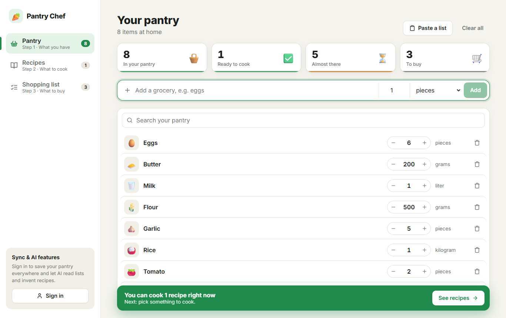
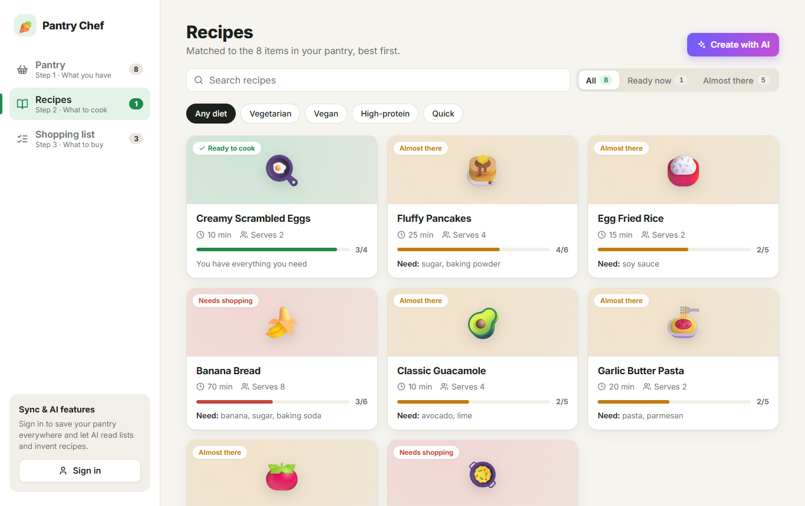
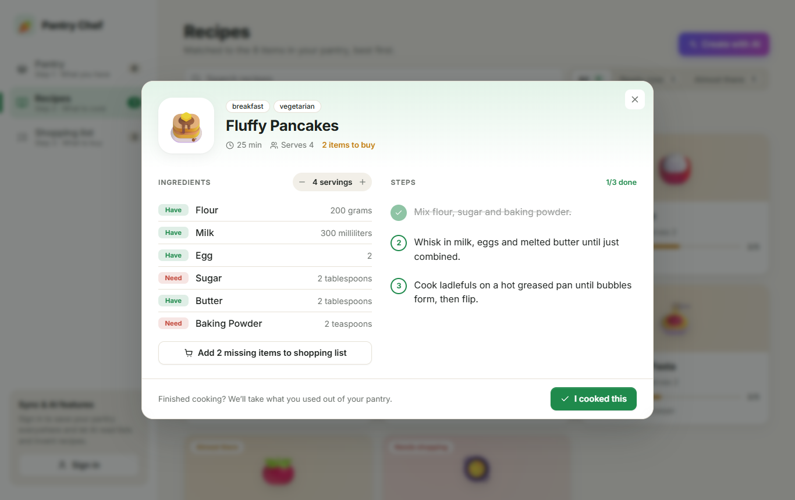
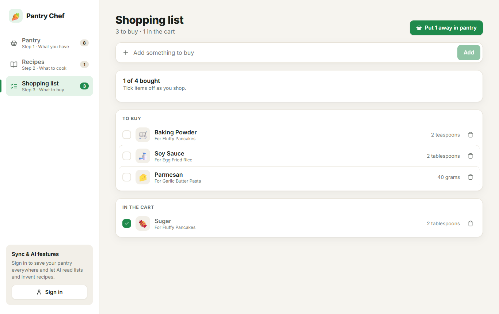
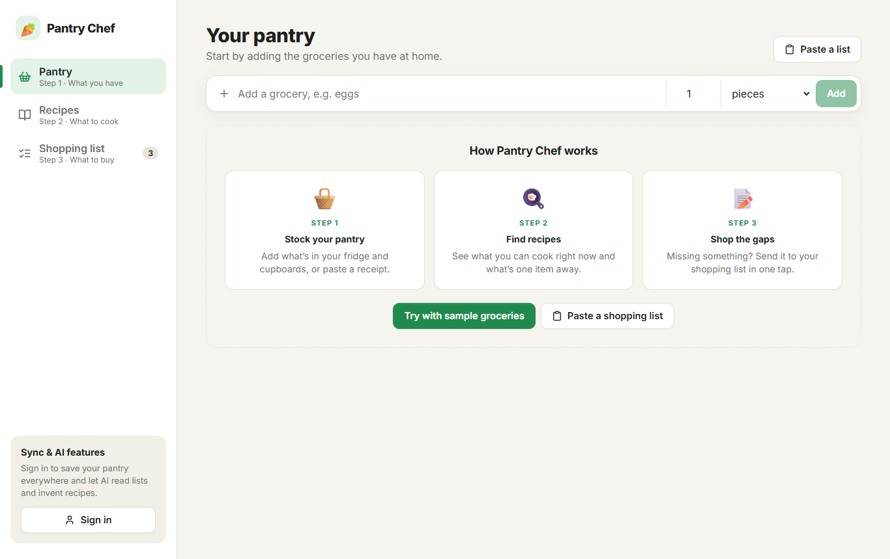
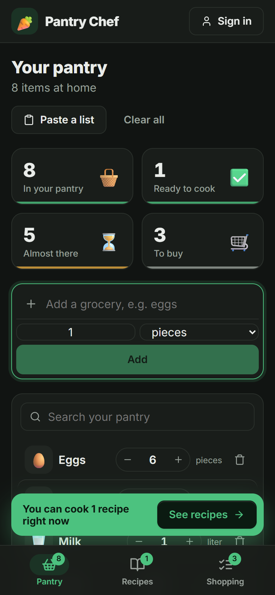
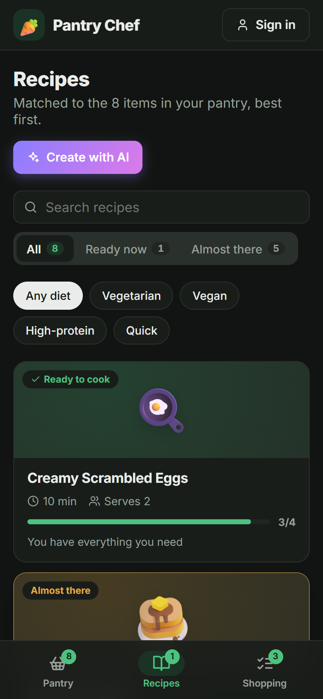
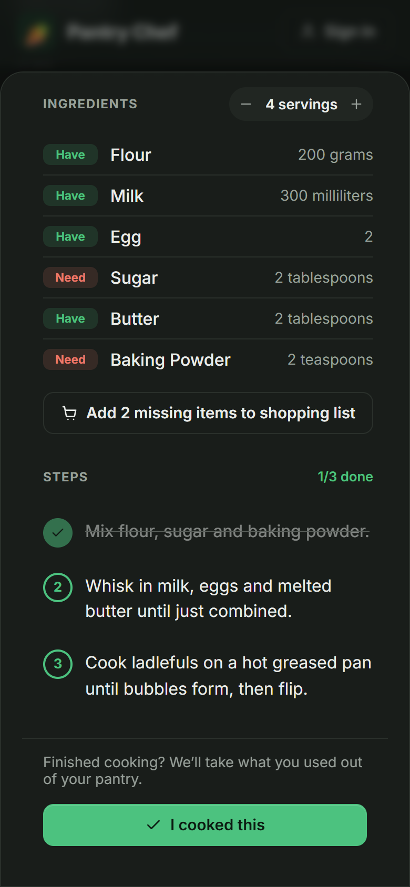

# 🥕 Pantry Chef

Pantry Chef suggests recipes based on the groceries you have. Enter what's in your kitchen and how much of it, and it ranks recipes by how much of each one you can already cover. It shows which ingredients you have, which are running low and which you need to buy.

> 🚧 **This is an ongoing project under active development.** The React frontend now reads recipes and matches from a FastAPI + Supabase backend, so you need the API running (with a database) to see recipes. Expect breaking changes; see [docs/ROADMAP.md](docs/ROADMAP.md) for where things are headed.

## Screenshots



| Recipes matched to your pantry | Recipe detail |
| --- | --- |
|  |  |
| **Shopping list** | **First run** |
|  |  |

<p align="center">
  
  
  
</p>

## Features

- **Three-step flow:** **Pantry → Recipes → Shopping list**, with a sidebar on desktop and a bottom tab bar on mobile. Each step shows a live count.

- **Grocery input with amounts and units:** pieces, grams, kilograms, milliliters, liters, teaspoons, tablespoons, cups. If you add the same item twice, the amounts are merged. Each item has −/+ steppers and a food emoji, and stat widgets summarize what you can cook.
- **Smart matching:**
  - Units are converted, so 1 kg of rice covers a recipe that needs 250 g.
  - Simple plurals match their singular ("tomatoes" matches "tomato").
  - Mass and volume are compared approximately (about 1 g per ml).
  - Optional ingredients count for less.
- **Ranked results** with a coverage meter, search, **Ready now** / **Almost there** tabs and dietary chips (vegetarian, vegan, …).
- **Recipe detail view:** each ingredient is labelled Have, Low or Need. A servings stepper scales quantities, and you can tick off steps as you cook. **Add missing items to shopping list** sends what you lack to your list. **I cooked this** takes the ingredients you used out of your pantry.
- **Shopping list:** to-buy and in-cart sections with a progress bar. **Put away in pantry** moves bought items back into your pantry. The list is stored in this browser.
- **Undo** for removing items, clearing the pantry and cooking, plus smooth view, card and list animations (turned off under reduced-motion settings).
- **Accounts and sync:** sign in with an email magic link (Supabase Auth) and your pantry is saved to the API. Signed out, it's stored in `localStorage`.
- **AI features (Claude, signed-in users):**
  - **Snap groceries:** on a phone, the camera button opens the rear camera. Photograph your fridge, a shelf, a receipt or a handwritten list, and AI turns it into items you review and edit before adding. Photos are shrunk in the browser first, so they upload quickly over mobile data.
  - **Saved photos:** each photo is kept in your account (a private Supabase Storage folder only you can read) and shown under **Your photos**, where you can read it again or delete it.
  - **Upload or paste:** a PDF, a text file, or pasted text works the same way.
  - **Cook something from my pantry:** AI writes a recipe around what you have, with optional dietary, time and servings constraints. Generated recipes are clearly marked **AI-generated**.
- **Responsive and dark-mode aware.**

## Tech stack

| Layer    | Choice                                     |
| -------- | ------------------------------------------ |
| UI       | React 19 + TypeScript                      |
| Build    | Vite                                       |
| Lint     | oxlint (frontend), ruff (backend)          |
| API      | FastAPI + SQLAlchemy 2.0                   |
| Database | Supabase Postgres                          |
| Auth     | Supabase Auth (`supabase-js`), verified by the API |
| AI       | Claude API via the `anthropic` Python SDK (server-side only) |
| CI       | GitHub Actions: lint + build, ruff + pytest |

## Getting started

Requires **Node.js 20+**.

```bash
git clone https://github.com/Kev1nDang/pantry-chef.git
cd pantry-chef
npm install
npm run dev
```

Then open http://localhost:5173. Recipes come from the API, so start the backend too (below).

**Sign-in (optional):** copy [`.env.example`](.env.example) to `.env.local` and set `VITE_SUPABASE_URL` and `VITE_SUPABASE_ANON_KEY` (Supabase dashboard → Project Settings → API). In Supabase → Authentication → URL Configuration, add `http://localhost:5173` to the redirect URLs so magic links come back to the dev server. Without these variables the app runs signed out and the AI features are unavailable.

| Script            | What it does                         |
| ----------------- | ------------------------------------ |
| `npm run dev`     | Start the dev server with hot reload |
| `npm run build`   | Type-check and build to `dist/`      |
| `npm run preview` | Serve the production build locally   |
| `npm run lint`    | Lint with oxlint                     |

### Backend

Requires **Python 3.11+** and a [Supabase](https://supabase.com) project.

1. **Create the database schema.** Either run `npx supabase link --project-ref <ref>` and then `npx supabase db push --include-seed`, or paste each file in [`supabase/migrations/`](supabase/migrations) in order, followed by [`supabase/seed.sql`](supabase/seed.sql), into the Supabase SQL editor.
2. **Configure and run the API:**

   ```bash
   cd backend
   python -m venv .venv
   .venv/Scripts/activate        # macOS/Linux: source .venv/bin/activate
   pip install -r requirements-dev.txt
   cp .env.example .env          # fill in DATABASE_URL, SUPABASE_URL and ANTHROPIC_API_KEY
   fastapi dev app/main.py       # http://localhost:8000/docs
   ```

3. **Run checks:** `pytest`, `ruff check .` and `ruff format --check .`. Tests fake the database and the Claude API, so they need no secrets or network.

While both servers are running, the Vite dev server forwards `/api/*` to `localhost:8000`. If that port is taken (on Windows, Hyper-V/WSL can reserve it), run the API with `fastapi dev app/main.py --port 8001` and set `API_PROXY_TARGET=http://localhost:8001` in `.env.local`.

| Method | Path                | Auth | Purpose                           |
| ------ | ------------------- | ---- | --------------------------------- |
| GET    | `/api/health`       |      | API and database status           |
| GET    | `/api/recipes`      |      | List recipes (`?q=` searches titles, `?tag=vegan` filters, repeatable) |
| GET    | `/api/recipes/{id}` |      | Recipe detail                     |
| POST   | `/api/recipes/match` |     | Body `{pantry, tags?}` → ranked matches |
| POST   | `/api/recipes/generate` | ✓ AI | Body `{pantry?, dietary?, maxMinutes?, servings?}` → an AI-generated recipe, matched against the pantry |
| GET    | `/api/pantry`       | ✓    | The signed-in user's groceries    |
| PUT    | `/api/pantry`       | ✓    | Replace the user's grocery list   |
| POST   | `/api/pantry/parse` | ✓ AI | Body `{text}` → parsed items to review (nothing is saved) |
| POST   | `/api/pantry/parse-file` | ✓ AI | Multipart `file`: a photo (JPEG/PNG/WebP/GIF), PDF or text file, up to 5 MB → parsed items to review |

Saved photos don't go through the API: the web app uploads them straight to the private `pantry-photos` Storage bucket with the user's session, and row level security keeps each user to their own `<user id>/` folder ([migration](supabase/migrations/20261026000000_pantry_photos.sql)).

Authenticated routes expect a Supabase access token in the `Authorization: Bearer <jwt>` header. JSON uses camelCase, matching `src/types.ts`.

**AI routes** call Claude from the server only; the key never reaches the browser. They need a signed-in user, are limited to `AI_RATE_LIMIT_PER_MINUTE` requests per user (default 10, in memory per API process), and return `503` with a clear message when `ANTHROPIC_API_KEY` isn't set. The model defaults to `claude-sonnet-5-5` (`ANTHROPIC_MODEL`). Requests opt into Anthropic's server-side refusal fallback (`fallbacks: "default"`); set `ANTHROPIC_FALLBACKS=false` if you route through a gateway or cloud platform that doesn't support it.

## Project structure

```
backend/
├── app/
│   ├── main.py             # FastAPI app, CORS, routers
│   ├── config.py           # Settings from env / .env
│   ├── db.py               # SQLAlchemy engine + session dependency
│   ├── auth.py             # Supabase JWT verification (JWKS or legacy HS256)
│   ├── models.py           # ORM mappings
│   ├── schemas.py          # Pydantic models (mirror src/types.ts, camelCase on the wire)
│   ├── api/                # health, recipes (list/detail/match/generate), pantry (+ parse)
│   └── services/
│       ├── matching.py     # Recipe scoring/ranking
│       ├── units.py        # Unit conversion
│       ├── ai.py           # All Claude calls: list/photo parsing, recipe generation
│       ├── documents.py    # Upload type detection, PDF/text extraction
│       └── ratelimit.py    # Per-user limit for AI routes
└── tests/                  # pytest; fakes for the DB session and Anthropic client
supabase/
├── migrations/             # SQL schema (source of truth), row level security, photo bucket
└── seed.sql                # Seed recipes
src/
├── App.tsx                 # App shell: navigation, recipe matching requests, dialogs, toasts
├── components/
│   ├── Sidebar.tsx         # Sidebar nav + account card; TabBar for mobile
│   ├── SignInDialog.tsx    # Magic-link sign-in
│   ├── PantryView.tsx      # Pantry page: stats, quick add, list, onboarding
│   ├── RecipesView.tsx     # Recipes page: search, tabs, diet chips, card grid
│   ├── ShoppingView.tsx    # Shopping list page
│   ├── StatTiles.tsx       # Count-up stat widgets
│   ├── GroceryForm.tsx     # Quick-add bar: name / amount / unit
│   ├── GroceryList.tsx     # Editable grocery list with steppers
│   ├── AddWithAIDialog.tsx # AI: photo / file / pasted text → review → add
│   ├── PhotoViewer.tsx     # A saved photo: read it again or delete it
│   ├── CookDialog.tsx      # AI: generate a recipe from the pantry
│   ├── RecipeCard.tsx      # Ranked result card with coverage meter
│   ├── RecipeDetail.tsx    # Ingredient status, servings scaling, steps, "I cooked this"
│   ├── ToastBar.tsx        # Toast with optional Undo action
│   ├── Icon.tsx            # Inline SVG icons
│   └── Modal.tsx           # Shared dialog shell (bottom sheet on mobile)
├── lib/
│   ├── api.ts              # Typed API client
│   ├── supabase.ts         # Supabase client (null when not configured)
│   ├── useSession.ts       # Current Supabase session
│   ├── usePantry.ts        # Grocery list: localStorage or synced to /api/pantry
│   ├── usePhotos.ts        # Saved photos in Supabase Storage
│   ├── image.ts            # Shrink and re-encode photos before upload
│   ├── useShoppingList.ts  # Shopping list in localStorage
│   ├── useToast.ts         # Single toast with auto-dismiss
│   ├── foodEmoji.ts        # Grocery name → emoji
│   └── format.ts           # Amount formatting
├── types.ts                # Shared domain types
└── index.css               # Styles and theme tokens
```

## How matching works

Matching runs on the server (`backend/app/services/matching.py`, behind `POST /api/recipes/match`). For each recipe ingredient it:

1. Finds the grocery item with a matching name. It tries an exact match after normalizing, then a substring match.
2. Converts both amounts to a base unit (g, ml or pieces) and works out *have ÷ need*.
3. Marks the ingredient **enough** (≥ 1), **partial** (< 1), **missing**, or **unknown** when the units can't be compared, such as pieces against grams.

A recipe's score is the weighted coverage across its ingredients, with optional ingredients weighted at 0.25. A recipe is **ready** when every required ingredient is fully covered.

## Roadmap

See [docs/ROADMAP.md](docs/ROADMAP.md) for the planned backend, data and infrastructure work.

## License

[MIT](LICENSE)
